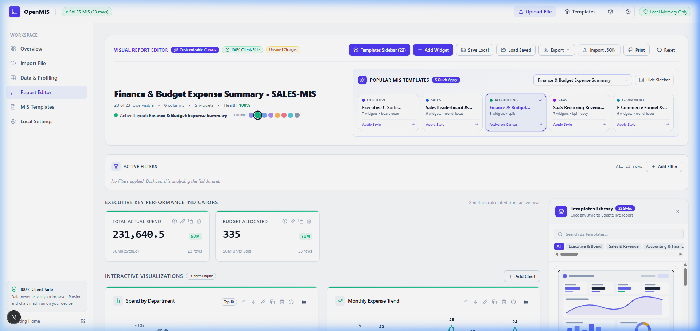
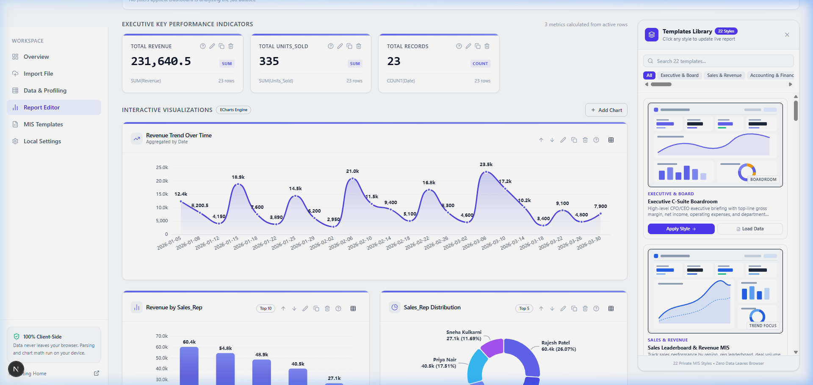
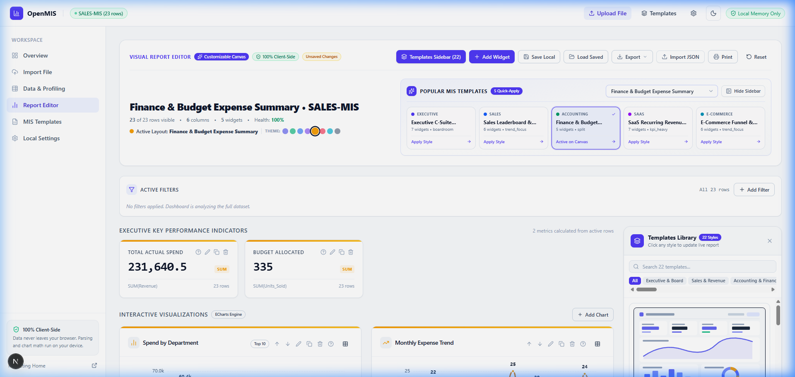
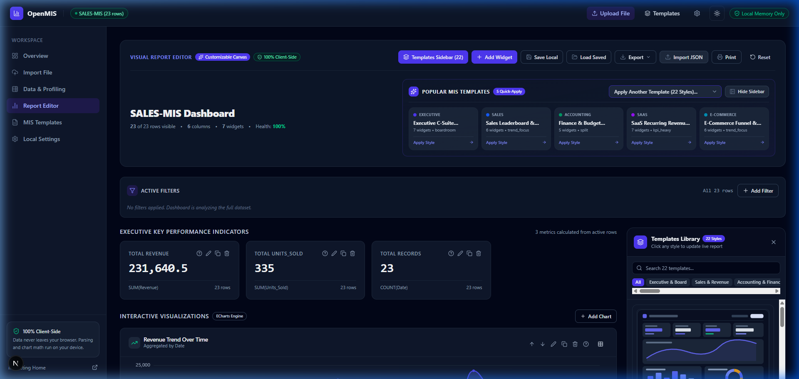

<div align="center">

# 📊 Nexdial OpenMIS
### Free, Privacy-First MIS & Excel Dashboard Builder

[](https://app.nexdial.io/)
[](https://github.com/sabledattatray/app.nexdial)
[](LICENSE)
[](SECURITY.md)

<p align="center">
  <strong>Transform raw spreadsheets into boardroom-grade interactive MIS dashboards in seconds.</strong><br>
  100% browser-local execution • Zero cloud transmission • Zero hallucination • Free & Open Source
</p>

[**🌐 Launch Live Application (app.nexdial.io)**](https://app.nexdial.io/) • [**📑 Explore 22+ Templates**](https://app.nexdial.io/templates) • [**📖 Architecture Docs**](docs/architecture/overview.md)

</div>

---

## 📸 Product Screenshots

<div align="center">

### Executive Boardroom Dashboard
*Real-time executive dashboard with KPI metrics, trend charts, and template theme customization.*


<br/>

### Multi-Visual Boardroom Analytics
*Interactive Apache ECharts visualizations with data tables, donut composition, and trend analysis.*


<br/>

### Dynamic Executive Color Themes
*Instantly switch between 8 tailored boardroom palettes (Indigo, Emerald, Amber, Rose, Cyan, etc.).*


<br/>

### Sleek Light & Dark Modes
*Full light and dark mode support with accessible semantic tables and boardroom print headers.*


</div>

---

## 🌟 Why Nexdial OpenMIS?

Traditional enterprise BI tools (Power BI, Tableau) require expensive recurring licenses, steep learning curves, and cloud storage compliance hurdles. Cloud AI dashboard tools frequently hallucinate calculations or upload private client numbers to third-party model providers.

**Nexdial OpenMIS** provides a lightweight, instant alternative:
- **🔒 100% Privacy by Design:** All parsing, statistical profiling, and chart rendering happen client-side in your browser via Web Workers and IndexedDB. No rows or columns ever touch a server.
- **📐 100% Deterministic Calculations:** Verifiable mathematical formulas (Sum, Average, Min, Max, Count, Variance). Every metric card and chart features formula inspection modals.
- **⚡ Instant 1-Click Templates:** 22+ comprehensive MIS templates across Finance, Sales, SaaS, Inventory, HR, Operations, and Marketing.
- **🎨 Modern Visuals:** Full visual library including Slicers, Waterfall bridges, Data tables, Leaderboards, Gauges, and Funnels.
- **📄 Boardroom Print & PDF Mode:** Dedicated print stylesheets with executive metadata headers, confidentiality stamps, and page breaks.

---

## 📊 Comprehensive Visualizations Suite

Nexdial OpenMIS features an extensive catalog of executive visualizations powered by [Apache ECharts](https://echarts.apache.org/):

| Visual Type | Description | Key Features |
| :--- | :--- | :--- |
| **Interactive Slicers (`slicer`)** | Fast dimensional filter tile | In-card search, row count badges, active checkmark pills, instant 1-click cross-filtering across all widgets |
| **Executive Data Table (`table`)** | High-density data grid | Excel-style in-cell proportional volume bars, column sorting, search filter, rank badges, sticky header & summary footer |
| **Waterfall Variance Walk (`waterfall`)** | CFO profit & loss bridge | Transparent base placeholder, green additions, red reductions, theme anchor bar, hover step impact tooltips |
| **Leaderboard / Horizontal Bar (`horizontal_bar`)** | Ranked performance rankings | Horizontal theme gradients, rounded caps, right-aligned bold values, automated label truncation |
| **Classic Pie & Donut (`pie`, `donut`)** | Proportional composition | Outside callout labels with formatted values and percentages, active theme palette distribution |
| **Radial Metric Gauge (`gauge`)** | Speedometer / attainment gauge | Smooth progress arc (0–100%), precision needle pointer, centered percentage label |
| **Conversion Funnel (`funnel`)** | Stage drop-off pipeline | Descending trapezoid stages, formatted step values, automatic drop-off percentages |
| **Trend Area & Line Charts (`area`, `line`)** | Chronological trajectory | Smooth Bézier curves, gradient area fills, data point markers, formatted value callouts |
| **Correlation Scatter Plot (`scatter`)** | Multi-measure relationship | Dual-measure Cartesian mapping for statistical correlation and outlier detection |
| **Executive KPI Cards (`kpi`)** | Top-line scorecards | Large monospaced values, aggregation badges, trend indicators, mathematical formula modals |

---

## 📑 22+ Ready-to-Use Business Templates

Browse and load pre-configured layouts and sample datasets instantly from [app.nexdial.io/templates](https://app.nexdial.io/templates):

- **Executive & Board:** C-Suite Boardroom Briefing, Quarterly Review
- **Sales & Revenue:** Sales Leaderboard & Revenue MIS, Regional Deal Tracker
- **Accounting & Finance:** Finance & Budget Expense Summary, P&L Walk
- **SaaS & Subscriptions:** SaaS Recurring Revenue (MRR) & Churn Analysis
- **Supply Chain:** Inventory & Stock Depletion Status, Warehouse Fill
- **E-Commerce:** E-Commerce Funnel & Cart Conversion Tracker
- **Human Resources:** HR Headcount, Attendance & Overtime
- **Operations & Support:** Customer Support SLA Performance & Backlog
- **Marketing:** Campaign ROI, CAC & Multi-Channel Attribution
- **Project Delivery:** Sprint Burndown & Milestone Tracking

---

## 🛠️ Technology Stack

- **Framework:** [Next.js 16+ (Turbopack, App Router)](https://nextjs.org/)
- **UI & Architecture:** [React 19](https://react.dev/) + [TypeScript](https://www.typescriptlang.org/) (Strict Mode)
- **Styling:** [Tailwind CSS](https://tailwindcss.com/) with semantic CSS variables
- **Charts Engine:** [Apache ECharts](https://echarts.apache.org/) via reactive React hook
- **Spreadsheet Parsing:** [PapaParse](https://www.papaparse.com/) (CSV) + SheetJS (`xlsx`, `xls`)
- **Local Persistence:** Browser IndexedDB via [`idb`](https://github.com/jakearchibald/idb)
- **Validation:** [Zod](https://zod.dev/) (Report Definition Schema v1.0.0)
- **Unit & Domain Testing:** [Vitest](https://vitest.dev/) (79 passing tests across 16 suites)

---

## 🚀 Getting Started Locally

### Prerequisites
- Node.js `20.x` or later (tested on Node 22/24 LTS)
- npm or pnpm

### Installation

```bash
# 1. Clone the repository
git clone https://github.com/sabledattatray/app.nexdial.git
cd app.nexdial

# 2. Install dependencies
npm install

# 3. Start the development server
npm run dev
```

Open [http://localhost:3000](http://localhost:3000) in your browser.

### Quality Assurance & Testing

```bash
# Run unit and domain test suite (79 tests)
npm test

# Run TypeScript typechecker
npx tsc --noEmit

# Run production build
npm run build
```

---

## 🔒 Security & Privacy Architecture

- **No Remote Telemetry of Data:** Spreadsheet rows and headers are processed strictly in the user's browser memory.
- **Formula Injection Mitigation:** All CSV and Excel exports are sanitized against Dynamic Data Exchange (DDE) formula injection (`=`, `+`, `-`, `@`, `\t`, `\r`).
- **Strict Content Security:** Zero external script injections or unvetted tracking pixels.
- **Air-Gapped Operation:** Once loaded, OpenMIS can operate completely offline without an active internet connection.

---

## 👨‍💻 Author & Credits

Crafted with dedication by **[Datta Sable](https://dattasable.com/)**

- **Live Application:** [https://app.nexdial.io/](https://app.nexdial.io/)
- **GitHub Repository:** [https://github.com/sabledattatray/app.nexdial](https://github.com/sabledattatray/app.nexdial)
- **Website:** [https://dattasable.com/](https://dattasable.com/)

---

## 📄 License

This project is licensed under the [MIT License](LICENSE) — free for personal, commercial, and educational use.
