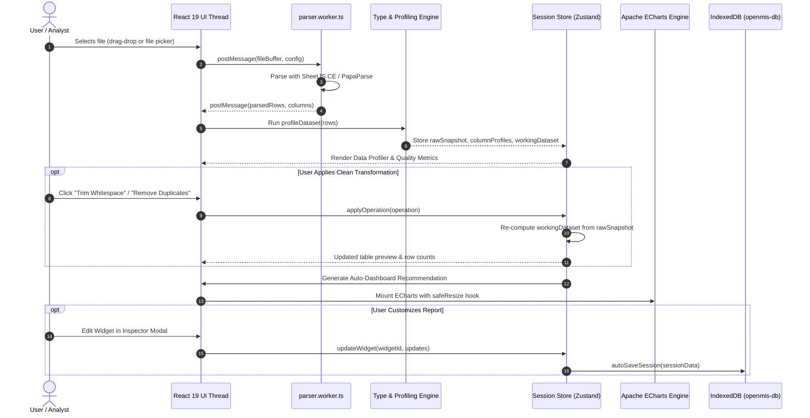

# Data Flow Architecture — OpenMIS

> **Version:** 1.0.0  
> **Date:** October 10, 2026  

---

## 1. Lifecycle of a Spreadsheet Session

---

## 2. In-Memory Dual Dataset Representation

OpenMIS prevents data loss by maintaining a dual dataset model in the client state:
- `rawSnapshot`: The immutable snapshot of parsed rows directly from the uploaded file or template.
- `transformations`: An ordered array of `TransformationOperation` objects:
  - `TRIM_WHITESPACE`
  - `REMOVE_DUPLICATES`
  - `FILTER_ROWS`
  - `DROP_COLUMNS`
  - `RENAME_COLUMN`
  - `CHANGE_COLUMN_TYPE`
- `workingDataset`: Derived deterministically by applying `transformations` sequentially to `rawSnapshot`.
- **Undo / Redo:** Undoing simply pops from the transformation stack and re-evaluates the pipeline in memory.
