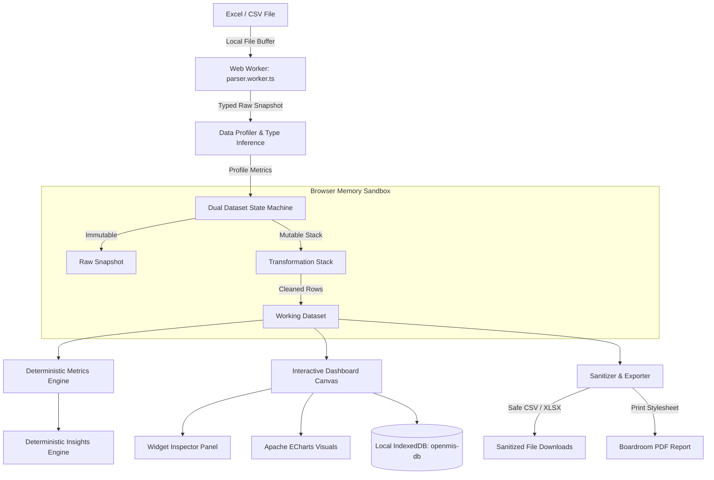

# Architecture Overview — OpenMIS

> **Version:** 1.0.0  
> **Status:** Production  
> **Date:** October 10, 2026  

---

## 1. High-Level System Architecture

OpenMIS is architected as a **100% client-side, browser-first** web application. It eliminates the traditional requirement for cloud BI ingestion pipelines, backend databases, and remote AI services.

---

## 2. Key Architectural Tenets

1. **Client-Side Data Boundary:** The user's spreadsheet binary buffer is kept inside browser RAM. No POST/PUT network requests carry cell contents.
2. **Deterministic Calculations:** Metrics (sums, averages, growth, IQR outliers) are calculated using pure TypeScript mathematical algorithms.
3. **Reversible Data State:** The application maintains the raw snapshot alongside an auditable operation history stack (`TransformationOperation[]`), enabling non-destructive undo/redo.
4. **Accessible Visuals:** Every ECharts visualization component includes an accessible toggle to display a semantic HTML data table.
5. **Anti-DDE Security:** File exports automatically escape formula injection characters (`=`, `+`, `-`, `@`, `\t`, `\r`) with single quotes.
